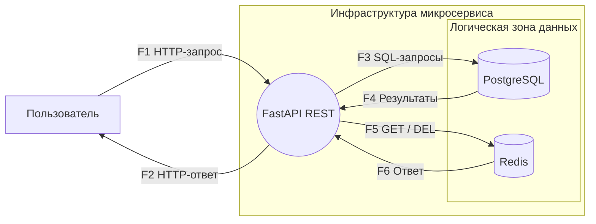

# Модуль B — Защита ИТ-инфраструктуры

Анализ безопасности учебного банковского микросервиса: DFD, STRIDE, Semgrep SAST и управление уязвимостями в Secure SDLC.

**Статус:** анализ выполнен; угрозы открыты. Исходный код не изменён. Динамическая эксплуатация не проводилась.


## Результаты задания

| Раздел | Материалы |
| --- | --- |
| 1.1. DFD | [Модель угроз](threat-model/README.md), [экспорт OWASP Threat Dragon (PDF)](threat-model/threat-dragon-report.pdf) |
| 1.2. Три угрозы и контрмеры | [STRIDE и оценка рисков](threat-model/README.md#приоритетные-угрозы) |
| 2.1. SAST | [Результаты и триаж](sast/README.md), [оригинальный JSON](sast/evidence/semgrep-results.json), [JSON с IDOR](sast/evidence/semgrep-results-with-idor.json) |
| Secure SDLC | [Процесс управления уязвимостями](docs/secure-sdlc.md) |
| Дополнительный отчёт | [Аналитический отчёт (PDF)](docs/analysis-report.pdf) |

## Архитектура



## Итоги анализа

| Показатель | Значение |
| --- | ---: |
| Версия Semgrep | 1.186.0 |
| Кастомных правил | 11 |
| Просканировано файлов | 8 (7 Python + Docker Compose) |
| Автоматических срабатываний | 12 |
| Ручных находок IDOR | 1 |
| Всего записей | 13 |
| ERROR / WARNING / INFO | 7 / 4 / 2 |
| Ошибок сканера | 0 |

Приоритетные угрозы: подмена личности и BOLA/IDOR (25/25), нарушение целостности баланса при конкурентных переводах (20/25), компрометация PostgreSQL (20/25). В Threat Dragon все три отмечены High, статус Open.

Два INFO-срабатывания относятся к динамическому формированию номеров параметров SQL. SQL Injection в предоставленном коде не подтверждена. Количество срабатываний не равно количеству независимых уязвимостей.

## Структура

```text
microservice/       исходники из задания без изменений
threat-model/       модель Threat Dragon, PDF, описание DFD и STRIDE
sast/               правила, результаты, триаж
sast/evidence/      оригинальные результаты, дополненный JSON, ручной реестр
sast/rules/         11 кастомных правил
scripts/            воспроизведение SAST и добавление IDOR
docs/               аналитический PDF и Secure SDLC
.github/workflows/  предлагаемый GitHub Actions workflow
```

## Ограничения

Исходники имеют дефекты запуска: несовпадение импортируемых имён в `main.py` с определениями в `security.py` и `schemas.py`, отсутствует Dockerfile. Анализ статический, модель описывает предполагаемую работу сервиса. Исправление кода и развёртывание не входят в задание. SCA зависимостей не выполнялся.
