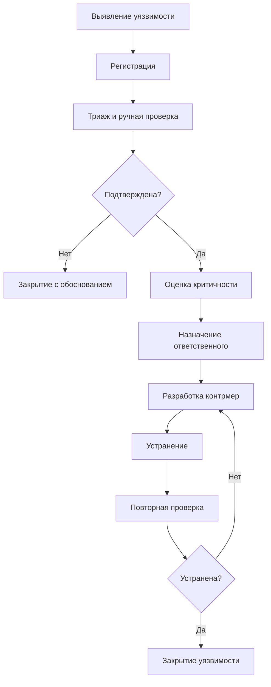

# Управление уязвимостями на уровне Secure SDLC

## Цель

Своевременное выявление, оценка и обработка уязвимостей
банковского микросервиса на всех этапах жизненного цикла
разработки программного обеспечения.

## 1. Этапы Secure SDLC

| Этап | Мероприятия по безопасности | Результат |
|---|---|---|
| Формирование требований | Определение требований безопасности и защищаемых активов | Требования безопасности |
| Проектирование | Построение DFD, моделирование угроз STRIDE | Модель угроз |
| Разработка | Secure Coding, Code Review, SAST | Перечень уязвимостей |
| Тестирование | Проверка авторизации, бизнес-логики и конкурентных операций | Подтверждение уязвимостей |
| Подготовка к выпуску | Оценка остаточных рисков | Решение о допуске к выпуску |
| Эксплуатация | Мониторинг, анализ инцидентов, повторные проверки | Актуальный реестр рисков |

## 2. Жизненный цикл уязвимости

## 3. Выявление уязвимостей

Для выявления недостатков безопасности рекомендуется
использовать следующие методы:

- SAST — статический анализ исходного кода.
- DAST — динамический анализ работающего приложения.
- SCA — анализ сторонних зависимостей.
- Secret Scanning — поиск учётных данных в исходном коде.
- Анализ инфраструктурных конфигураций.
- Ручной анализ бизнес-логики и авторизации.
- Моделирование угроз.

В рамках задания фактически выполнены моделирование
угроз, SAST с помощью Semgrep и ручной статический анализ.

Остальные методы являются рекомендациями.

## 4. Регистрация уязвимостей

Каждая обнаруженная уязвимость должна содержать:

- уникальный идентификатор;
- название и описание;
- расположение в исходном коде;
- источник обнаружения;
- классификацию CWE;
- оценку критичности;
- потенциальные последствия;
- рекомендуемые контрмеры;
- ответственного за обработку;
- срок устранения;
- текущий статус.

Результаты сканирования представлены в разделе
[SAST](../sast/README.md).

## 5. Триаж

На этапе триажа специалист по информационной безопасности:

1. Проверяет достоверность срабатывания сканера.
2. Исключает ложноположительные результаты.
3. Объединяет находки с общей первопричиной.
4. Определяет достижимость уязвимого кода.
5. Оценивает влияние на бизнес-процессы.
6. Назначает приоритет обработки.

Примером триажа является анализ двух информационных
срабатываний Semgrep, связанных с динамическим SQL.

По результатам ручной проверки наличие SQL Injection
не подтверждено: пользовательские данные передаются
в запросы посредством параметризации.

## 6. Приоритизация и сроки устранения

Приоритет определяется с учётом технической критичности,
вероятности реализации угрозы и потенциального ущерба
для банковских бизнес-процессов.

| Критичность | Предлагаемый срок устранения |
|---|---|
| Critical | До 24 часов |
| High | До 7 календарных дней |
| Medium | До 30 календарных дней |
| Low | До 90 календарных дней |

Указанные сроки являются предлагаемой внутренней
политикой, а не нормативными требованиями.

Для критических и высоких рисков рекомендуется
запрет выпуска приложения до устранения уязвимости
либо формального согласования остаточного риска.

## 7. Распределение ответственности

| Роль | Ответственность |
|---|---|
| AppSec-специалист | Выявление, триаж, оценка рисков, повторная проверка |
| Разработчик | Устранение уязвимостей программного кода |
| DevOps-инженер | Устранение инфраструктурных недостатков |
| DBA | Безопасность PostgreSQL и целостность данных |
| QA-инженер | Функциональные и регрессионные тесты безопасности |
| Владелец сервиса | Приоритизация работ и согласование остаточных рисков |

## 8. Обработка выявленных рисков

| Риск | Приоритет | Ответственный | Проверка устранения |
|---|---|---|---|
| Подмена личности и IDOR | Critical | Backend / AppSec | Тесты межпользовательского доступа |
| Race Condition | Critical | Backend / DBA | Конкурентные тесты переводов |
| Небезопасная конфигурация PostgreSQL | Critical | DevOps / DBA | Проверка секретов, ролей и сетевой доступности |
| Небезопасная конфигурация Redis | High | DevOps | Проверка ACL, TLS и сетевой изоляции |
| Недостатки кеширования | Medium | Backend | Проверка актуальности истории транзакций |

Приоритеты соответствуют предлагаемой внутренней
шкале оценки рисков.

## 9. Повторная проверка

После устранения уязвимости необходимо:

1. Повторить SAST-сканирование.
2. Проверить изменённый участок исходного кода.
3. Выполнить соответствующие тесты безопасности.
4. Убедиться в отсутствии регрессий.
5. Обновить реестр уязвимостей.
6. Зафиксировать результат повторной проверки.

Закрытие уязвимости допускается только после
подтверждения эффективности реализованных контрмер.

## 10. Метрики эффективности

Для контроля процесса рекомендуется использовать:

- количество открытых уязвимостей по критичности;
- среднее время устранения уязвимостей (MTTR);
- долю уязвимостей, устранённых в установленный срок;
- количество повторно возникающих уязвимостей;
- долю ложноположительных срабатываний;
- охват исходного кода статическим анализом.

## Заключение

Интеграция мероприятий информационной безопасности
в жизненный цикл разработки позволяет выявлять
уязвимости до ввода банковского микросервиса
в эксплуатацию и снижать потенциальные финансовые,
операционные и репутационные риски.

В рамках задания выполнено выявление и описание
уязвимостей, проведён триаж и предложены контрмеры.

Исправление исходного кода, внедрение контрмер
и повторное тестирование после устранения уязвимостей
не выполнялись, поскольку не входят в рамки задания.
